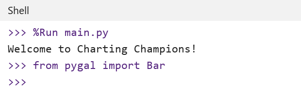

# Get ready in Thonny

1. [Download the starter files](archives/charting-champions-starter.zip). In File Explorer, right-click the ZIP, choose **Extract All** and open the extracted folder. Keep `main.py` and the four CSV files together.
2. Open **Thonny** from the Start menu. The interpreter shown at the bottom right should be local Python 3. If you see MicroPython, click the interpreter name and choose **Local Python 3** or Thonny’s bundled Python.
3. Choose **File → Open** and select the extracted `main.py`. The upper editor pane is where you write your program. The **Shell** below shows messages when it runs. Choose **View → Shell** if it is hidden.
4. Press **F5** (the green **Run current script** button). Look for `Welcome to Charting Champions!` in the Shell.

## Check that you can draw charts

At the `>>>` prompt in the Shell, type `from pygal import Bar` and press Enter. If a fresh prompt appears, you are ready.

If you see `ModuleNotFoundError`, open **Tools → Manage packages**, search for **pygal**, select the package named **pygal** and click **Install**. Close the package window and try the import again. If installation is restricted, ask your facilitator to add Pygal to the selected interpreter.

For the next step, click back into the **main.py editor tab**. Save your changes with **Ctrl+S** and run them with **F5**.
