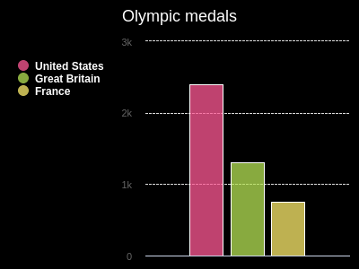
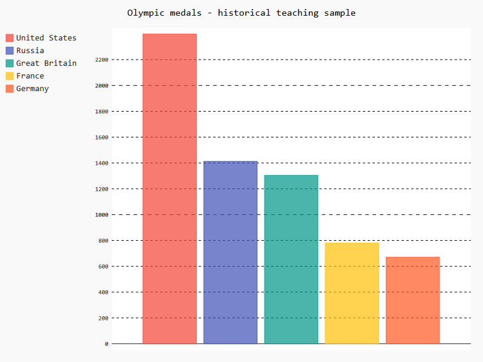

# Store data in lists

Look at this line:

```python
us = ['United States', 2399]
```

A list groups related values inside square brackets. Python counts positions from zero:

| Expression | Value | Type |
| --- | --- | --- |
| `us[0]` | `'United States'` | Text/string |
| `us[1]` | `2399` | Whole number/integer |

Add these lists and chart entries **before** the final `render_to_file()` line:

```python
ru = ['Russia', 1413]
gb = ['Great Britain', 1304]
chart.add(ru[0], ru[1])
chart.add(gb[0], gb[1])
```

Run the code and refresh the chart. Predict what would happen if you tried `gb[2]`. That position does not exist: it causes an `IndexError`.

## Read a chart



The original project shows a different selection of three teams. Match each bar to its team using the legend. Which two teams appear in both this picture and your chart?

## Your turn

Add France with 780 medals and Germany with 671 medals. Create one list and one `chart.add()` call for each. Keep the output line last.

## Checkpoint

There are five bars. The United States bar is the tallest in this sample. Explain to your partner why `chart.add(gb[0], gb[1])` needs both indexes.



If chart interactivity loads, hover over a bar and click a name in the legend. What changes when you hide the largest series? If hover is unavailable, read the scale and labels instead.
