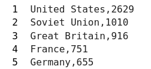

# Read data from a file

Typing a list for every country would take a long time. A CSV file stores values in rows with commas between columns.



Look at the first row of this source example. Which character separates the name from the count? The numbers down the left are editor line numbers. Your file uses a different historical sample.

In Thonny, choose **File → Open** and select `medals.csv` from your extracted folder. Choose **All files** in the file picker if needed. It contains the same five historical sample rows and no heading row:

```text
United States,2399
Russia,1413
Great Britain,1304
France,780
Germany,671
```

Click the `main.py` tab. Choose **File → Save as** and save it as `lists_chart.py` in the same folder. Reopen `main.py` using **File → Open** so your list version stays available. In `main.py`, replace the lists and `chart.add()` calls with:

```python
with open('medals.csv', encoding='utf-8') as data_file:
    for line in data_file:
        print(line.strip())
```

Leave the import, chart creation and output line in place. Run it. An empty chart is expected at this stage: you have printed the file contents but have not added them to the chart.

`with open(...)` opens the file and closes it when the block finishes. The `for` loop visits each row. Four spaces indent each nested level. `strip()` removes surrounding whitespace, including the newline at the end of a row.

## Checkpoint

Thonny’s Shell displays five rows. Explain which line repeats and why. If Python cannot find the file, run the program from the extracted starter folder.
