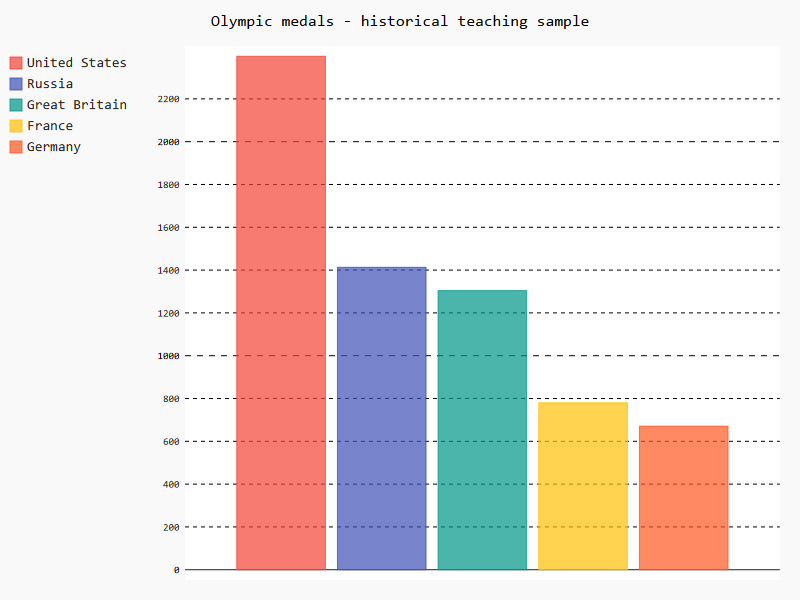

# Turn file rows into bars

Each line read from a file is text. Split it at the comma and convert the second item into a number.

In Thonny, replace the contents of `main.py` with this program. Press **F5**, then refresh the browser tab showing `chart.svg`.

```python
from pygal import Bar

chart = Bar()
chart.title = 'Olympic medals - historical teaching sample'

with open('medals.csv', encoding='utf-8') as data_file:
    for line in data_file:
        if line.strip():
            pieces = line.strip().split(',')
            team = pieces[0]
            medals = int(pieces[1])
            chart.add(team, medals)

chart.render_to_file('chart.svg')
```

The `if` skips blank lines. `split(',')` makes a two-item list. `int()` changes text such as `'2399'` into the number `2399`. The output line is outside the loop, so the completed chart is saved once.

This simple parser is for our two-column examples without quoted commas. Real CSV files can be more complicated; Python's `csv` module handles those cases.

## Checkpoint

The file-driven chart matches your five-bar chart. You no longer need a separate `chart.add()` line per country.



## Try a change

Make a copy named `practice.csv`, add `Example Team,100`, then change the filename in your program. Update the title to say "Practice data". You should now see six bars. The additional team is fictional.
