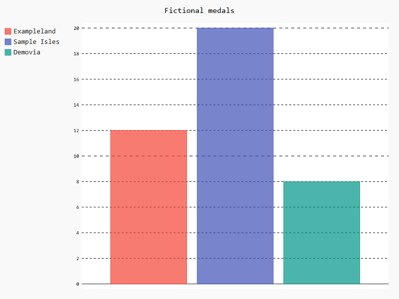
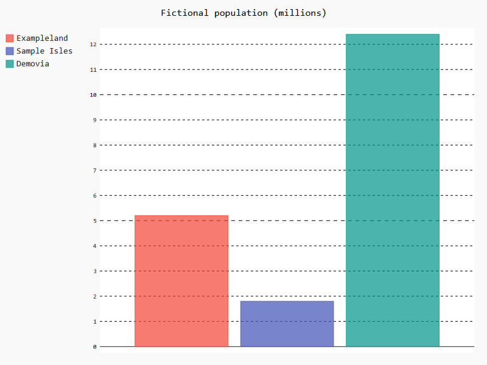
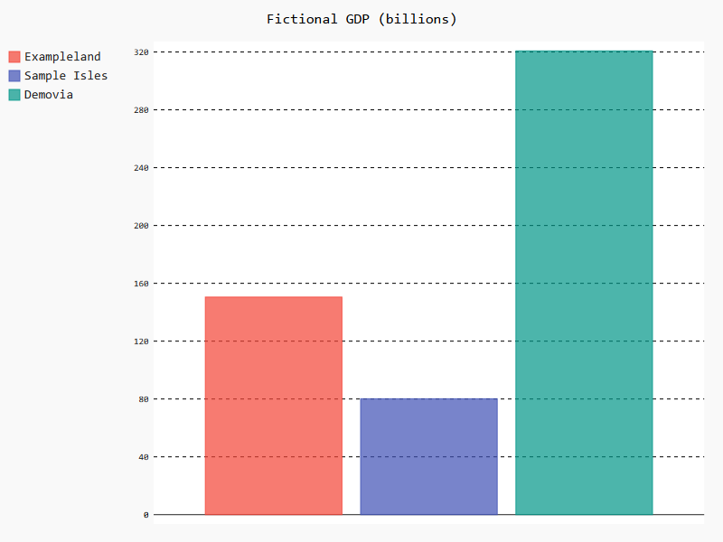

# Investigate population and wealth

The original project asks whether population and GDP might help explain medal counts. A chart can suggest a question, but cannot prove its explanation.

## First, practise with fictional data

The starter ZIP includes three files for the same three **invented countries**. None of these values describes a real country.

| File | Values | Conversion | Suggested title |
| --- | --- | --- | --- |
| `practice_medals.csv` | Medal count | `int()` | Fictional medals |
| `pop.csv` | Population in millions | `float()` | Fictional population (millions) |
| `gdp.csv` | GDP in billions of example currency units | `float()` | Fictional GDP (billions) |

1. Save your medal program before editing it.
2. Change the input filename to `practice_medals.csv` and update the title. Change the output filename to `practice-medals.svg`, then press **F5**.
3. Repeat for `pop.csv`, using `population = float(pieces[1])` and `chart.add(team, population)`. Save as `population.svg`.
4. Repeat for `gdp.csv`, using `gdp = float(pieces[1])` and `chart.add(team, gdp)`. Save as `gdp.svg`.

Use `float()` because population and GDP examples contain decimal values. Preserve a separate output for each chart so you can compare them.

## Discuss

- Does the country with the most people have the most medals in this fictional example?
- Does the country with the largest GDP have the most medals?
- Why can we not use invented data to make claims about real countries?
- What other information might matter: years participating, sporting investment, or events entered?

## Original-project extension

Open [Charting champions](https://projects.raspberrypi.org/en/projects/charting-champions/0) and use its supplied medal, population and GDP files to repeat the investigation with its historical datasets. Keep those files in a separate folder so they do not get mixed with our fictional examples. Check dates, units, coverage and country definitions. If those details are unavailable, state that limitation. Do not assume historical medal totals and a population snapshot cover the same period.

## Checkpoint

Show three correctly titled charts and describe one pattern and one limitation. Association is not proof that one factor caused another.

Compare each browser tab with its example below. Check the title and the scale on the left.

**practice-medals.svg**

**population.svg**

**gdp.svg**

